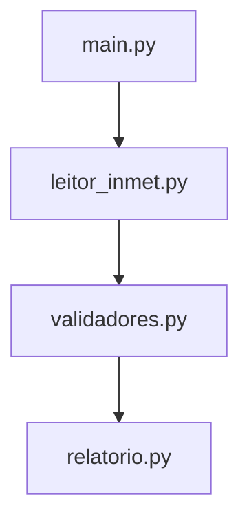

<div align="center">


</div>
# Projeto 1 — Validação de Dados Reais de uma Estação Meteorológica

| Campo | Valor |
| --- | --- |
| **Disciplina** | Técnicas de Programação (PE2) |
| **Etapa** | 1 de 3 |
| **Professor** | Claudio Fernandes |
| **Formato** | Individual |
| **Valor** | 10 pontos (100% da 1ª avaliação) |
| **Prazo** | último commit na `main` até **29/10/2026 (quinta-feira) às 23h59** |

## 1. O problema

Sensor de verdade falha. Ele fica sem energia, perde a conexão, quebra e passa meses
sem medir. Quem processa esses dados precisa decidir o que fazer com cada falha, e não
pode deixar o programa cair por causa dela.

Você vai processar **um ano inteiro de dados reais** da estação automática do INMET em
São Luís (código A203, ano de 2025): são 8.760 leituras horárias de temperatura,
umidade, chuva e vento. O arquivo está em `dados/` **exatamente como o INMET publica**,
sem nenhuma limpeza. Antes de escrever código, abra o arquivo num editor de texto e
observe:

- as 8 primeiras linhas não são dados, são **metadados** da estação;
- o separador é `;` e o decimal é **vírgula** (`27,5`). `float("27,5")` dá erro;
- o arquivo **não é UTF-8**, e sim latin-1. Abrir sem informar o encoding quebra nos acentos;
- há horas com campos **vazios**, quando o sensor não registrou;
- a partir de setembro, o anemômetro (sensor de vento) **parou de funcionar**.

Fonte: INMET, dados históricos (portal.inmet.gov.br/dadoshistoricos).

## 2. O que implementar

Complete os três módulos. O comportamento esperado de cada função está na **docstring**
dela. Leia a docstring inteira antes de começar.

| Módulo | Funções |
| --- | --- |
| `validadores.py` | `converter_leitura`, `validar_tipo`, `validar_faixa`, `validar_lote` |
| `leitor_inmet.py` | `ler_metadados`, `ler_registros`, `extrair_coluna`, `agrupar_por_mes` |
| `relatorio.py` | `resumir`, `contar_motivos`, `salvar_relatorio` |

`main.py`, `verificar.py` e `formatar_linha_variavel` (em `relatorio.py`) **já estão prontos**.

> ⚠️ **Regras**
> - Use o conteúdo da Etapa 1: módulos, exceções completas (`try/except/else/finally`,
>   `raise`, `raise ... from`, exceções customizadas) e a biblioteca padrão (`csv`).
> - **Não altere** assinaturas, nomes de exceções, `main.py` nem `verificar.py`. O professor
>   roda a versão original dos dois na correção.
> - Proibido `except:` ou `except Exception: pass` engolindo erro. Toda exceção capturada
>   precisa ter um tratamento que faça sentido.
> - Sem `pandas`/`numpy`: o objetivo é você mesmo tratar os dados.

## 3. Como testar

Rode **de dentro da pasta `projeto1/`**, porque os caminhos são relativos a ela:

```powershell
python verificar.py   # 25 testes automáticos — mostra o que passou e o que falta
python main.py        # gera o relatório completo e grava relatorio.txt
ruff check .          # avisos de estilo (o Ruff foi instalado na aula de VS Code)
```

Comece pelo `validadores.py`. Os testes do leitor e do relatório dependem dele.

## 4. Onde e como entregar

Você **não cria** repositório. Use o repositório privado que já é seu na organização
`Campus-Monte-Castelo`: `tecnicas-2026-2-<sua matrícula>` (apostila de Git, §2.4).

Na aula do Bhaskara você fez `git init` e `git remote add`, porque o repositório ainda
não existia. Aqui ele **já existe** no GitHub, então o caminho é outro: `git clone`, que
baixa o repositório já ligado ao `origin`. Não rode `git init` nem `git remote add`.

1. No terminal do VS Code, a partir da pasta `projetos` (a mesma das aulas práticas):

   ```powershell
   git clone https://github.com/Campus-Monte-Castelo/tecnicas-2026-2-SUA_MATRICULA.git
   cd tecnicas-2026-2-SUA_MATRICULA
   git config user.name "Seu Nome"
   git config user.email "email-da-sua-conta@github"
   ```

2. Baixe o `projeto1.zip` do Classroom. Ele já traz a pasta `projeto1/` com tudo dentro,
   inclusive o CSV do INMET em `dados/` e o `.gitignore`. No Explorador de Arquivos,
   clique com o botão direito no zip, escolha **Extrair tudo** e, no destino, **apague o
   final que o Windows sugere** e deixe só a pasta do repositório:

   ```text
   C:\Users\SEU_USUARIO\projetos\tecnicas-2026-2-SUA_MATRICULA
   ```

   Confira antes de seguir. O comando abaixo precisa mostrar `True`:

   ```powershell
   Test-Path projeto1\main.py
   ```
3. Faça o primeiro commit **antes de alterar qualquer arquivo**:

   ```powershell
   git add projeto1
   git commit -m "chore: adiciona arquivos iniciais do Projeto 1"
   git push
   ```

4. Trabalhe e faça commits ao longo dos dias (veja §5).
5. `git push` para a `main`. Na atividade do Classroom, cole o link do seu repositório
   em **Seu trabalho** e clique em **Entregar**. Para a nota vale o último commit na `main`
   até o prazo. Commit depois do prazo não é considerado, mesmo que você já tenha clicado
   em Entregar.

**Ainda não tem o repositório?** Mande o seu usuário do GitHub pelo formulário da turma
até **15/10/2026 (quinta-feira)**. Sem repositório não há como entregar, e isso não é motivo para
prorrogar o prazo.

### Estrutura final esperada

```text
tecnicas-2026-2-<matrícula>/
└── projeto1/
    ├── dados/INMET_NE_MA_A203_SAO LUIS_01-01-2025_A_31-12-2025.CSV   (sem alteração)
    ├── validadores.py      ← você implementa
    ├── leitor_inmet.py     ← você implementa
    ├── relatorio.py        ← você implementa
    ├── main.py             (sem alteração)
    ├── verificar.py        (sem alteração)
    ├── relatorio.txt       ← gerado pelo seu main.py e COMMITADO
    ├── README.md           ← o SEU README (substitui este enunciado, ver §6)
    └── .gitignore
```

**Não devem ir para o repositório:** `.venv/`/`venv/`, `__pycache__/`, `*.pyc`, `.vscode/`.
O `.gitignore` já cuida disso. Confira com `git status` antes de cada commit.

## 5. Histórico de commits

O histórico é parte da nota, porque ele mostra **como** você chegou ao resultado.

- No mínimo **6 commits** além do inicial, em **pelo menos 3 dias diferentes**.
- **Um commit por mudança**, com os prefixos das aulas práticas: `feat:` (função nova),
  `fix:` (correção), `refactor:` (reorganização sem mudar comportamento), `docs:` (README)
  e `chore:` (arquivos de apoio, como o commit inicial).
  Mensagens como `update`, `ajustes` ou `final` não contam.
- **Nunca use `git add .`**: adicione o arquivo que você mudou. Antes de cada commit,
  `git status` e `git diff` (saia com `q`).
- Teste antes de commitar: rode o `verificar.py` e veja o que mudou.
- Um único commit com o projeto inteiro pronto **zera** este critério.

**Uma branch e um Pull Request por módulo** (o Desafio B da aula de Consolidação):

| Branch | O que entra nela |
| --- | --- |
| `feat/validadores` | `validadores.py` |
| `feat/leitor-inmet` | `leitor_inmet.py` |
| `feat/relatorio` | `relatorio.py` e o `relatorio.txt` gerado |

Para cada uma: `git switch -c feat/validadores`, commits pequenos, `git push -u origin
feat/validadores`, abra o Pull Request no GitHub **com uma descrição do que foi feito e
a saída do `verificar.py`**, faça o *Merge*, e depois `git switch main` e `git pull`.
Os 3 PRs mergeados ficam na aba *Pull requests* do repositório e são conferidos na correção.

**Pelo menos um commit feito no editor web** (github.dev, tecla `.`): por exemplo, o
ajuste final do README. Depois disso, `git pull` no computador antes de continuar.

Um histórico típico (cada PR aparece como um commit de *merge*):

```text
docs: ajusta alerta do README (feito no github.dev)
docs: escreve o README do Projeto 1
Merge pull request #3 from .../feat/relatorio
feat: gera relatorio.txt com os dados reais
feat: implementa resumir e contar_motivos
fix: trata lista vazia em resumir (vento sem dados)
Merge pull request #2 from .../feat/leitor-inmet
feat: agrupa registros por mês
feat: lê registros do CSV com encoding latin-1
Merge pull request #1 from .../feat/validadores
feat: implementa validar_lote separando válidas e inválidas
feat: implementa converter_leitura com vírgula decimal
chore: adiciona arquivos iniciais do Projeto 1
```

## 6. O seu README.md

Substitua este enunciado por um README seu, com:

1. Ryan Silva de Sousa, 20261EE0009, Engenharia Industrial Elétrica
2. O sistema lê arquivos CSV com dados meteorológicos do INMET (estação de São Luís/MA), realiza o tratamento e validação defensiva de leituras individuais e em lote (identificando ausências de dados ou valores fora dos limites físicos) e gera um relatório consolidado com médias, mínimos, máximos e dados mensais de temperatura, umidade, chuva e vento.
> [!WARNING]
> **Atenção:** Os dados do anemômetro (sensor de vento) da estação meteorológica de São Luís (A203) apresentaram ausência de medições (`SEM DADOS`) entre os meses de outubro e dezembro de 2025.
### Fluxo de Processamento


3. python verificar.py
   python main.py
4. [validadores]
  ✅ converter '27,5' -> 27.5
  ✅ converter ' 0 ' -> 0.0
  ✅ converter '' lança ErroCampoAusente
  ✅ converter 'abc' lança ErroTipoInvalido
  ✅ exceções herdam de ErroDeSensor
  ✅ validar_tipo('5') lança ErroTipoInvalido
  ✅ validar_tipo(True) lança ErroTipoInvalido
  ✅ validar_faixa(500) retorna 500
  ✅ validar_faixa(-1) lança ErroLeituraInvalida
  ✅ validar_faixa nos limites é válido
  ✅ validar_lote: válidas
  ✅ validar_lote: inválidas

[leitor_inmet]
  ✅ metadados: estação
  ✅ metadados: código
  ✅ 8760 registros horários
  ✅ primeira temperatura é '27,5'
  ✅ apelido inexistente lança KeyError
  ✅ 12 meses agrupados, em ordem
  ✅ fevereiro tem 672 horas
  ✅ arquivo errado lança ErroFormatoArquivo
  ✅ arquivo inexistente lança FileNotFoundError

[relatorio]
  ✅ resumir([]) retorna None
  ✅ resumir([1, 2, 4])
  ✅ contar_motivos
  ✅ salvar_relatorio grava em UTF-8

Resultado: 25/25 testes passaram

Estação SAO LUIS (A203) — MA
Registros horários lidos: 8760

5. Decidi chamar converter_leitura() logo no início de validar_faixa() para tratar dados brutos em formato de texto (ex: "27,4") antes de realizar comparações numéricas, evitando que exceções de tipo (TypeError) quebrassem a execução.

Foram criadas exceções customizadas herdeiras de ErroDeSensor (ErroCampoAusente, ErroTipoInvalido, ErroLeituraInvalida) para categorizar com precisão a causa de cada falha de medição no relatório final.
6. Ferramenta: Gem da Disciplina

Apoio na checagem de erros, entendimento da estrutura de dados do INMET e orientação no fluxo de versionamento Git/GitHub.

Recusei sugestões iniciais de alterar o arquivo main.py (pois ele era somente leitura) e optei por aplicar o tratamento defensivo diretamente dentro dos módulos de validação, além de ajustar manualmente a chave de coluna na extração dos dicionários de leitura.

A regra para a IA é a mesma das aulas práticas: **leia tudo o que ela gerar antes de
aceitar**, e peça a explicação de qualquer trecho que você não entendeu. O Copilot em modo
Agent consegue fazer os 25 testes passarem sozinho. Por isso os testes não valem a nota
inteira, e a arguição (fim da §7) existe.

O visual segue o README que você refez na aula de Consolidação (Bloco 7), e **tem de
renderizar na página do GitHub**:

- cabeçalho centralizado com **badges estáticos** do shields.io (o repositório é
  privado, então badges dinâmicos não funcionam);
- pelo menos um **alerta** (`> [!NOTE]`, `> [!TIP]` ou `> [!WARNING]`). Uma boa escolha é
  avisar que o vento não tem dados de outubro a dezembro;
- um **diagrama Mermaid** do fluxo entre os módulos (`main` → `leitor_inmet` →
  `validadores` → `relatorio`);
- a **estrutura de pastas** dentro de um `<details>`;
- nada de CSS, `style` ou `font`: o GitHub remove.

## 7. Critérios de avaliação

| Critério | Pontos | Como é avaliado |
| --- | ---: | --- |
| Testes automáticos | 4,0 | `verificar.py` original: proporcional aos 25 testes |
| Relatório real | 1,0 | `main.py` roda sem erro e o `relatorio.txt` commitado é igual ao que o seu código gera |
| Uso de exceções | 1,5 | exceção certa em cada caso, `raise ... from`, `else` onde faz sentido, nenhum erro engolido |
| Legibilidade | 0,5 | `ruff check .` sem avisos, nomes claros, sem `print` de depuração esquecido |
| README.md | 1,5 | as 6 seções da §6, com conteúdo seu, e badges, alerta, Mermaid e `<details>` renderizando no GitHub |
| Histórico Git | 1,5 | regras da §5: commits com prefixo em 3 dias, 3 PRs mergeados com descrição, 1 commit pelo github.dev |
| **Total** | **10,0** | |

> O professor pode pedir que você explique, sem consulta, qualquer função do seu
> projeto. Se você não souber explicar o próprio código, os pontos daquela parte podem
> ser revistos.

## 8. Checklist antes do prazo

- [ ] `python verificar.py` mostra 25/25.
- [ ] `python main.py` roda sem erro e o `relatorio.txt` foi commitado.
- [ ] `ruff check .` não mostra avisos.
- [ ] `main.py`, `verificar.py` e o CSV não foram alterados (`git diff` vazio nos três).
- [ ] O README.md é o seu, com as 6 seções da §6.
- [ ] No mínimo 6 commits além do inicial, em 3 dias diferentes, com prefixo.
- [ ] 3 Pull Requests mergeados (um por módulo), cada um com descrição.
- [ ] Pelo menos um commit feito pelo github.dev.
- [ ] README conferido **na página do GitHub**: badges, alerta e diagrama aparecem desenhados.
- [ ] `git status --short --branch` mostra `## main...origin/main`, sem *ahead* nem *behind*.
- [ ] Na página do repositório, no GitHub, a pasta `projeto1/` aparece com tudo dentro.
- [ ] Link do repositório colado na atividade do Classroom e **Entregar** clicado.

## 9. Problemas comuns

| Sintoma | Causa provável | O que fazer |
| --- | --- | --- |
| `FileNotFoundError` no CSV | terminal fora da pasta `projeto1` | `cd projeto1` e rode de novo |
| `projeto1\projeto1\main.py` (pasta repetida) | o "Extrair tudo" criou uma pasta a mais | mova o conteúdo um nível acima e apague a pasta vazia; `Test-Path projeto1\main.py` deve dar `True` |
| `UnicodeDecodeError` | `open()` sem `encoding="latin-1"` | informe o encoding ao abrir o CSV |
| `ValueError: could not convert string to float: '27,5'` | vírgula decimal | troque a vírgula por ponto antes do `float()` |
| Colunas erradas ou `KeyError: 'Data'` | as 8 linhas de metadados não foram puladas | leia e descarte 8 linhas antes do `DictReader` |
| `ZeroDivisionError` em `resumir` | lista vazia (sensor sem dados no mês) | trate a lista vazia antes de dividir |
| `git clone` pede senha ou dá 404 | convite não aceito, ou outra conta logada | aceite o convite no e-mail e confira a conta no navegador |
| `git push` rejeitado | commit feito pelo site (github.dev) e ainda não baixado | `git pull --no-rebase --no-edit` e depois `git push` |
| Diagrama aparece como código | bloco não aberto com a linguagem `mermaid` | corrija a abertura do bloco e confira no GitHub |
| Badge quebrado | badge dinâmico em repositório privado | use só badges estáticos (`img.shields.io/badge/...`) |
| `git switch` recusa trocar de branch | alterações não commitadas | commite (ou `git restore`) antes de trocar |
| `__pycache__` aparece no `git status` | `.gitignore` não foi copiado | copie o `.gitignore` do pacote para `projeto1/` |

---
IFMA — Monte Castelo · Técnicas de Programação · Prof. Claudio Fernandes
Projeto desenvolvido por Ryan Silva - Engenharia Industrial Elétrica